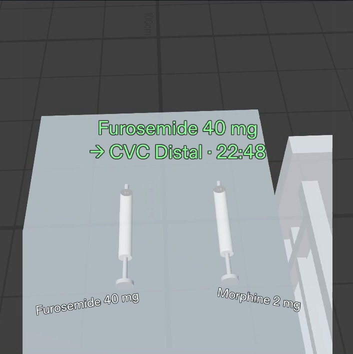
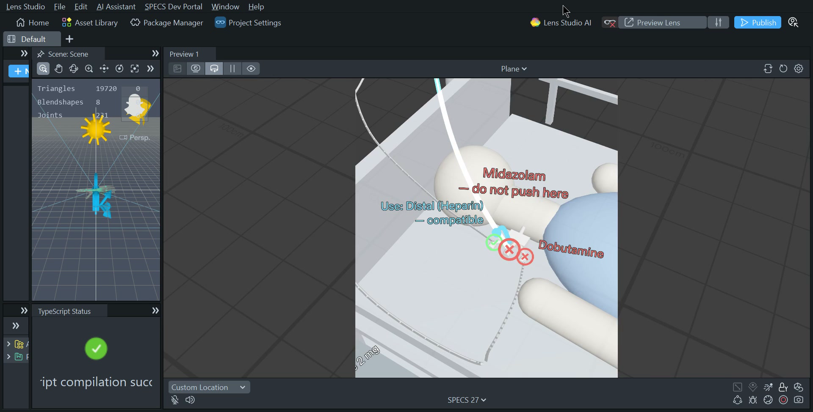

# Lumen

**Lumen: an AR Lens for SPECS that shows ICU nurses which IV port is safe for the drug in their hand, and lights any line from port to pump.**

*Learn AR with SPECS (Devpost Learn) · Lens Studio 5.24.1 · SPECS 27 · TypeScript · LEAF 10/10 in the Lens Studio preview*

## Demo video


- ▶ **Demo film (2:23, with voice-over):** [`devpost/demo/lumen-demo.mp4`](devpost/demo/lumen-demo.mp4). The demo is
  **real Lens Studio 5.24.1 footage** of this repo's project: the whole app first, then a zoom into the SPECS view, with the
  pinches driven by a LEAF scenario through the Lens's real SIK interactables. The 3D opening shots use the Lens's own bedside
  models. How it was made: [`devpost/VIDEO.md`](devpost/VIDEO.md). YouTube: _link after upload_.
- 🌐 **Try it in your browser:** https://vivekyarra.github.io/Lumen/ — press **▶ Play the story**, or click around yourself
  (click = pinch). Deployed by [`.github/workflows/pages.yml`](.github/workflows/pages.yml) on every merge to `main`.


## How Lumen meets the judging criteria

| Criterion | What Lumen shows | Where to check |
|---|---|---|
| **Design** — a complete, coherent product | One real user (an ICU nurse) and one real workflow, done end to end: quiet → pick up → check → trace → redirect → push → quiet, plus an out-of-view pump alarm and a one-pinch shift-handoff line check. Pinch only, big targets, information on the thing it's about, silent when not needed. | Demo video · [story mode](https://vivekyarra.github.io/Lumen/?story) |
| **Technical implementation** | A real Lens Studio 5.24.1 SPECS project, wired and tested through the **Lens Studio MCP** with Snap's **CLAD** plugin. **10/10 LEAF scenarios pass in the Lens Studio preview**: they pinch the Lens's real SIK interactables. One shared TypeScript core (the only data file, state machine, layout, meshes, sounds) drives the Lens, a browser twin and the tests. The same DC1–DC10 run on three runners, with fuzzing (≈100k random inputs), real-click and stress tests, and CI on every PR. | [`leaf-results.md`](devpost/leaf-results.md) · [`clad-verification.md`](devpost/clad-verification.md) · [`build-log.md`](devpost/build-log.md) · Actions tab |
| **Innovation** | Clinical line safety on glasses: answers *which tube is this* by lighting the real tube, and *is it safe* by marking the real port — using all three SPECS strengths (shares your view, draws in the world, keeps hands free). Fail-safe by design. | [Why glasses](#why-glasses) |
| **Presentation** | 10-second hook, one nurse's story, the real app on screen, the design reasons, proof (LEAF run), 2:23. | [`devpost/VIDEO.md`](devpost/VIDEO.md) |

## The problem

An ICU patient often has several IV drugs running at once: each one flows from a bag, through a pump,
down a tube into a port on a central line or a peripheral IV. The tubes hang, cross and tangle. Before
every push, the nurse has to answer two questions — *which line is this?* and *will my drug react with
what is already flowing in it?* — by tracing tubes with gloved fingers and checking a compatibility chart,
often on a computer away from the bed. Wrong-line and incompatible-drug errors are a known category of
IV medication error.

## Who it's for

**Maya, ICU nurse, 4 years in.** 1–2 critically ill patients per 12-hour shift, gloves on, syringe in hand.
She wants speed, certainty and her eyes on the patient — not menus, typing, floating screens or alerts
that never stop. Also: new-graduate and float nurses who don't know this patient's lines, and nurse educators.

## What it does

The Lens is almost silent at the bedside: faint dots on the ports. Maya picks up the **furosemide**
syringe — every port turns **green ✓** or **red ✕**, with the reason right on the port
(“✕ Midazolam”, “✕ Dobutamine”). She pinches the red Medial port: its tube lights **cyan** through the
tangle up to *Midazolam · 3 mL/h · Pump 1*, and a cyan arrow points to the nearest safe port —
“Use: Distal (Heparin) — compatible”. She pinches the Distal port, a big **Push here** appears; she
pinches it — a green pulse, a chime, a log line “Furosemide 40 mg → CVC Distal · 10:42” — and the Lens
goes quiet. Seconds later Pump 2 alarms out of view: a two-tone sound and an **amber edge arrow** turn
her to it, and Line 2 glows amber down to the **kinked** tube at the bed rail. “Resolved.” With
**morphine**, all four ports are green — the colours come from data, not fixed art.

**Shift handoff, one pinch.** At every handover ICU nurses trace each line from bag to patient. Pinch the
IV pole and Lumen walks the lines for you — each one lights from bag through pump to port with its drug,
rate and port name, 2.5 s each — then goes quiet and logs *“Lines checked · 4 of 4 · 07:02”*.

**Fail-safe by design.** A drug pair missing from the table is never green (“✕ Not in table — check
chart”), and if no port on the patient is safe, Lumen draws no arrow to nowhere: it says
*“No safe port — ask pharmacy”*.

In the Lens Studio 5.24.1 preview (SPECS 27 view):

| | | |
|---|---|---|
|  |  |  |
|  |  |  |



The web twin (same Core, Three.js) is in [`devpost/screenshots/`](devpost/screenshots/) and live at https://vivekyarra.github.io/Lumen/.

## Why glasses

| Strength | In Lumen |
|---|---|
| **It shares your view** | The nurse looks at a port; Lumen answers about *that* port. |
| **It draws in the world** | The line lights up along the real tube, through the tangle, to the real pump and bag. Markers sit *on* the ports. |
| **It leaves your body free** | Gloved hands stay on the syringe. Eyes stay on the patient. No trip to a computer. |

On a phone you'd need a free hand, you'd hold it up, and you'd see a *picture* of the tangle instead of the
real one lighting up.

## How it was built

```
Assets/Lumen/Core/   engine-agnostic: LumenData (the ONLY data file) · CompatibilityEngine · LumenState
                     (state machine) · LumenLayout · Curves · ViewMath · MeshGen · SoundSynth · Scenarios (DC1–DC8)
Assets/Lumen/Lens/   Lens Studio: LumenLens (the one @component) · SceneBuilder · PortMarker · LineTracer ·
                     SyringeTray · PushButton · RedirectArrow · AlarmController · EdgeArrow · AudioCues · LumenSelfTest
Assets/Lumen/Leaf/   LEAF scenarios (one per done criterion, IK reach, in-preview DC1–DC10) + LeafIndex + Demo_Story
Assets/Lumen/Audio/  7 spatial sound cues, synthesised in code (tools/gen-audio.ts)
Assets/Scene.scene   the SPECS scene: Camera, SIK, Lumen (LumenLens), LeafIndex · Lumen.esproj at the repo root
preview-web/         a browser twin of the Lens Studio preview, rendering the same Core with Three.js
tests/               unit (Node), e2e (Playwright) — all run in GitHub Actions on every PR
tools/               recorders for the real Lens Studio preview + the film pipeline (tools/video)
devpost/             spec, LEAF + CLAD results, build log, screenshots, demo film
```

- **Plan:** Devpost Learn skill pack, `plan-lens` → `devpost/design-brief.md` (see checklist below).
- **Build:** Claude Code with Snap's **CLAD** plugin (`ls-clad`, enabled for this project in `.claude/settings.json`) and
  the **Lens Studio MCP**. Through the MCP the agent created the SPECS project, installed LEAF, wired `LumenLens` and
  `LeafIndex` into the scene, set the materials, lights and sounds, compiled, and ran every LEAF scenario. A separate
  Claude Code run used CLAD's own LEAF workflow against the open project: 10/10 passed
  ([`devpost/clad-verification.md`](devpost/clad-verification.md)).
  Everything in the Lens is generated at runtime from the shared Core by one component, `LumenLens`: procedural
  meshes via `MeshBuilder`, SIK pinch targets and spatial audio.
- **Visuals never decide logic:** every engine renders `LumenState.view()`. The same DC1–DC10 scenarios
  run against the state machine, the rendered web preview, and inside the Lens Studio preview.
- **Lens Studio 5.24.1**, SPECS Base Template (SPECS 27), Spectacles Interaction Kit 2.0, LEAF 2.0.2, TypeScript.

## Stand-ins (what is faked in the preview)

| Real product would… | In the preview Lumen… |
|---|---|
| Scan the syringe barcode with the camera | Pinch a 3D syringe on the cart (“pick up”) |
| See and follow real tubes with computer vision | Uses hard-coded line paths in the scene |
| Get drug names and rates from connected pumps / EHR | Uses hard-coded data in one data file |
| Use a licensed compatibility database | Uses a small hard-coded table (demo data; anything missing is never green) |
| Detect a real pump alarm over the network | Fires the alarm 4 s after the first confirmed push (plus a hidden test hook) |

## LEAF results

See [`devpost/leaf-results.md`](devpost/leaf-results.md). **10 / 10 scenarios** — the spec's DC1–DC8 plus
DC9 (handoff) and DC10 (fail-safe) — pass on the state machine and in the rendered web preview on every PR,
alongside ~100k fuzzed inputs, real-click and stress tests and a full story-mode playthrough (65 unit +
21 browser tests). **In the Lens Studio 5.24.1 preview, all 10 LEAF scenarios pass**
([`Assets/Lumen/Leaf/`](Assets/Lumen/Leaf/)):
- one scenario per done criterion, each pinching the Lens's real SIK interactables (`Syringe_S1_Hit`, `Port_B_Hit`,
  `PushHereButton`, …);
- an IK reachability scenario;
- one that runs all ten shared scenarios inside the preview (`[Lumen self-test] 10/10 pass`).

## How to open

**Lens Studio:** clone and open `Lumen.esproj` in **Lens Studio 5.24.1**. The scene is already wired, so press
**Preview**, look down-left at the central line and the cart, and turn left for the pumps. Controls: WASD move,
Q/E down/up, mouse look, **click = pinch**. To run the tests, open the LEAF panel and run any `test_*` scenario
([LENS_STUDIO_SETUP.md](LENS_STUDIO_SETUP.md)).

**Web preview (no Lens Studio needed):**

```bash
npm ci
```

```bash
npm run serve:web
```

Then open http://localhost:5173 — **▶ Play the story** (or press P), or explore: drag to look,
**click = pinch**, pinch the IV pole for a handoff check, F = SPECS 37° × 32° view, M = mute.

**Tests:**

```bash
npm test
```

```bash
npx playwright test
```

## What I learned

_Draft — rewrite in your own words before submitting:_

- The hard part is not the code; it is deciding when the Lens should be quiet.
- Put information on the thing it's about: a label on the port beats a panel in the air.
- Fake the sensing, build the response for real.
- SPECS sees only ~37° × 32°: the layout (where the cart sits, how long a label may be) had to be
  designed against that number, and tested against it.

## What's next

1. Real barcode scan of the syringe with the glasses camera.
2. Pump data over hospital interoperability standards instead of hard-coded data.
3. Vision-based line tracing on real tubes.
4. A licensed compatibility database.
5. A pilot with one ICU and nurse educators — training use first.
6. Regulatory path: in clinical use this is likely software as a medical device; start in training/simulation.

## Disclaimer

Hackathon prototype, not a medical device. The drug data in this repo was made up for the demo.

---

### Submission checklist status

| Item | Status |
|---|---|
| Lens Studio 5.24.1 SPECS project, scene wired through the Lens Studio MCP | ✅ `Lumen.esproj` + `Assets/Scene.scene` |
| CLAD plugin + Lens Studio MCP | ✅ `.claude/settings.json` · [`devpost/clad-verification.md`](devpost/clad-verification.md) |
| DC1–DC10 in the Lens Studio preview (LEAF) | ✅ 10/10 · [`devpost/leaf-results.md`](devpost/leaf-results.md) |
| DC1–DC10 on the state machine + rendered web preview | ✅ green in CI |
| Demo film with voice-over, real Lens Studio footage | ✅ [`devpost/demo/lumen-demo.mp4`](devpost/demo/lumen-demo.mp4) · upload to YouTube as Public |
| Web preview link for judges | ✅ live at https://vivekyarra.github.io/Lumen/ |
| `devpost/design-brief.md` from **your own** `plan-lens` interview | ⏳ run `plan-lens` (20–30 min, your answers) |
| Devpost form | ⏳ text in [`devpost/submission.md`](devpost/submission.md) |
