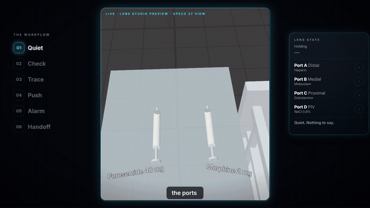
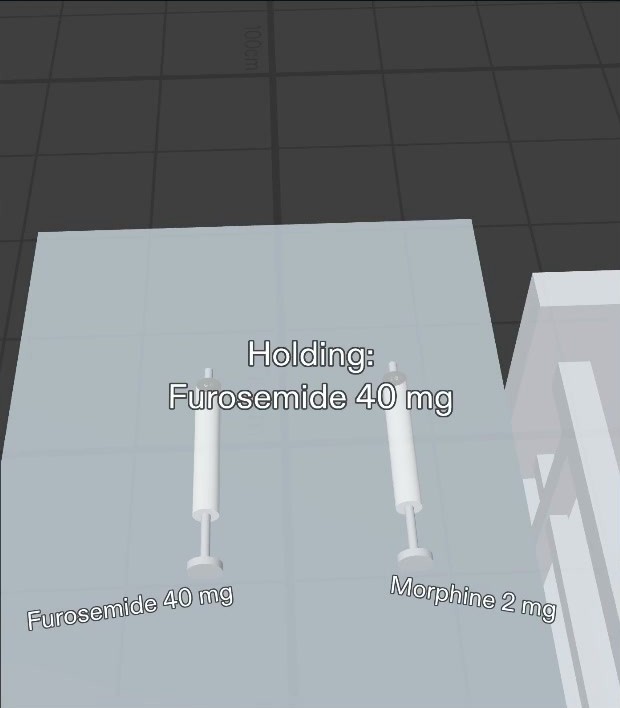
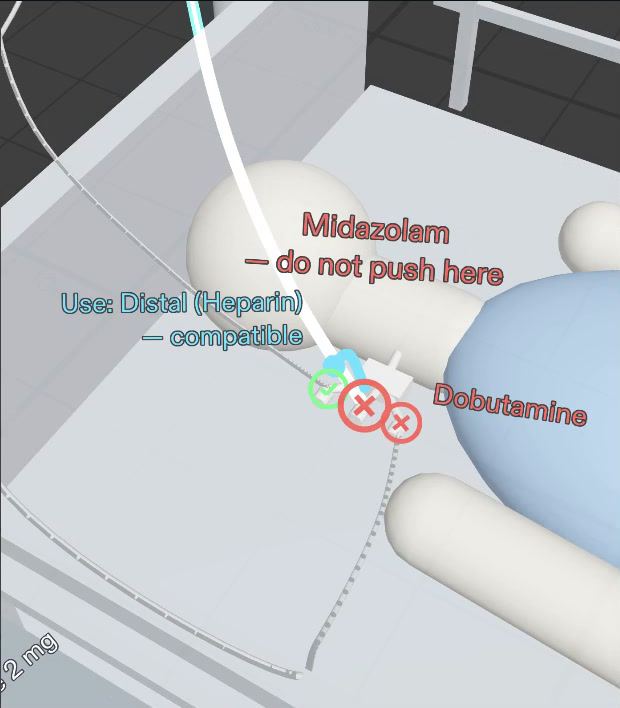
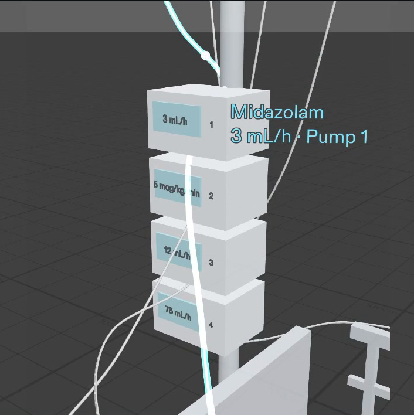
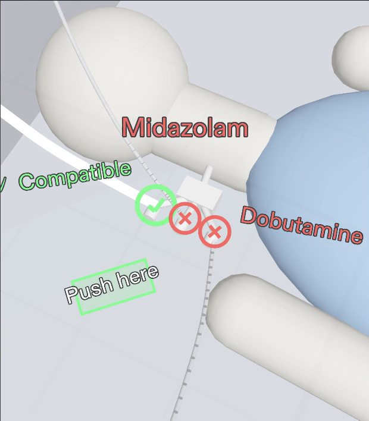
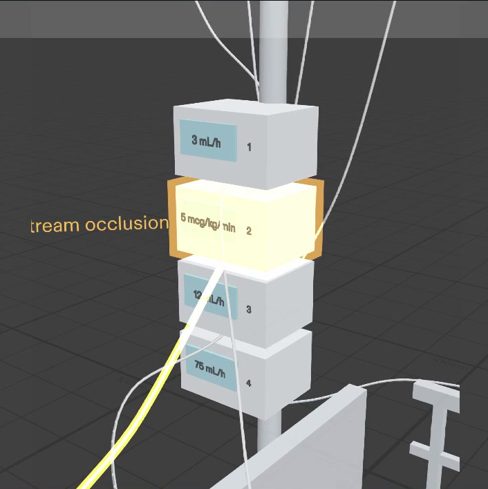
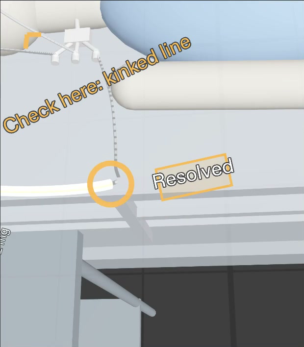
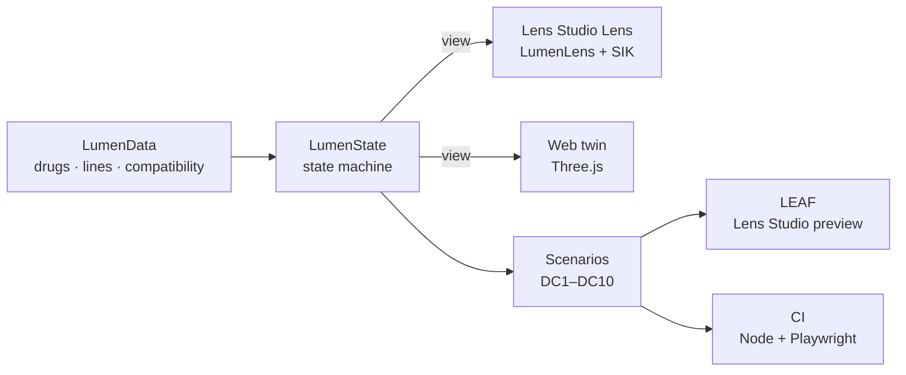

# Lumen

### The right line. The safe port. Where you look.

**Lumen is an AR Lens for Snap SPECS that shows ICU nurses which IV port is safe for the drug in their hand, and lights any line from port to pump.**


<p align="center"></p>

<p align="center">
  <a href="https://youtu.be/Ija_HBTAqF8"><b>▶ Watch the demo (2:28)</b></a> &nbsp;·&nbsp;
  <a href="https://vivekyarra.github.io/Lumen/"><b>🌐 Try it in your browser</b></a> &nbsp;·&nbsp;
  <a href="devpost/design-brief.md"><b>📐 Design brief</b></a> &nbsp;·&nbsp;
  <a href="devpost/leaf-results.md"><b>✅ LEAF results</b></a>
</p>

*Built for **Learn AR with SPECS** (Devpost Learn).*

---

## The problem

An ICU patient can have several IV drugs running at once, each from a bag, through a pump, down a tube into a port.
The tubes hang, cross and tangle. Before every push, the nurse has to answer two questions:
- **Which line is this?**
- **Will my drug react with what's already flowing in it?**

Today the answer means tracing tubes with gloved fingers and checking a compatibility chart away from the bed.

## Meet Maya

An ICU nurse, four years in. She cares for one or two critically ill patients per 12-hour shift, with gloves on and a
syringe in hand. She wants speed, certainty and her eyes on the patient. Lumen is built for her, and for the float
and new-graduate nurses who meet a patient's lines for the first time.

## What Lumen does

| | |
|---|---|
|  | **1 · Pick up the syringe.** Lumen reads the drug in her hand: *Holding: Furosemide 40 mg*. |
|  | **2 · Every port answers.** Green ✓ is safe. Red ✕ says why, right on the port: *✕ Midazolam: do not push here*, with an arrow to the safe port. |
|  | **3 · Pinch a port, see its line.** That one tube lights through the tangle, all the way to its pump: *Midazolam · 3 mL/h · Pump 1*. |
|  | **4 · Push here.** On the safe port, one pinch confirms. Lumen logs *Furosemide 40 mg → CVC Distal* and goes quiet. |
|  | **5 · An alarm she can't see.** Pump 2 alarms behind her. A chime and an edge arrow turn her head, and the line glows amber to the exact kink. |
|  | **6 · Resolved.** One pinch clears it. At shift change, one pinch on the IV pole walks every line, bag to pump to port. |

**Quiet by design:** at rest, Lumen shows only faint dots on the ports. It speaks up when a syringe is in her hand
or a pump needs her, and then gets out of the way. **Safe by default:** a drug pair Lumen doesn't know is never shown
as green, and when no port on the patient is safe, Lumen says *No safe port, ask pharmacy* instead of pointing anywhere.

## Why it needs glasses

| SPECS strength | In Lumen |
|---|---|
| **Shares your view** | She looks at a port; Lumen answers about that port. |
| **Draws in the world** | The answer sits on the port, and the line lights along the real tube to the real pump. |
| **Leaves your body free** | Gloved hands stay on the syringe and eyes stay on the patient. There's no screen to hold and no trip to a computer. |

## How it works



- **One TypeScript core** (`Assets/Lumen/Core`): the data, compatibility engine, state machine, layout, meshes and
  sounds. Visuals never decide logic; every engine renders `LumenState.view()`.
- **One Lens Studio component** (`LumenLens`) builds the whole bedside at runtime: procedural meshes,
  Spectacles Interaction Kit pinch targets and spatial audio.
- **The same done criteria run three ways:** LEAF in the Lens Studio preview, the state machine in Node, and the
  rendered web twin in Chromium. All three pass 10 / 10.

## Built with Claude Code + Snap CLAD

1. **Planned** with the Devpost Learn `plan-lens` skill, which wrote [`devpost/design-brief.md`](devpost/design-brief.md).
2. **Built by [Claude Code](https://claude.com/claude-code)** with Snap's **CLAD** plugin (`.claude/settings.json`) and
   the **Lens Studio MCP**:
   - created the SPECS project;
   - installed LEAF;
   - wired the scene, materials, lights and sounds;
   - compiled and ran the tests.
3. **Tested with LEAF:** 10 / 10 scenarios pass in the Lens Studio preview, by pinching the Lens's real interactables
   ([results](devpost/leaf-results.md)).

Lens Studio 5.24.1 · SPECS 27 · Spectacles Interaction Kit 2.0 · LEAF 2.0.2 · TypeScript · Three.js · Playwright · GitHub Actions

## Run it

**In Lens Studio**
1. Open `Lumen.esproj` in Lens Studio 5.24.1 and press **Preview** (SPECS 27, Interactive).
2. Look down-left at the central line and the cart, and turn left for the pumps.
3. Controls: WASD to move, Q/E down/up, mouse to look, **click = pinch**.
4. Tests: open the LEAF panel and run any `test_*` scenario.

**Try it without SPECS** (no install): open the web twin at https://vivekyarra.github.io/Lumen/. It runs the same core
as the Lens. Press **▶ Play the story**, or click around yourself; click = pinch.

**From source**

```bash
npm ci
```

```bash
npm run serve:web
```

```bash
npm run verify
```

`npm run verify` runs the typecheck, unit tests and browser tests.

## Repository

```
Lumen.esproj, Assets/, Packages/   the Lens Studio project (SPECS Base Template + SIK + LEAF)
Assets/Lumen/Core/                 shared TypeScript core: data, state machine, layout, meshes, sounds, scenarios
Assets/Lumen/Lens/                 Lens Studio components (LumenLens + one class per role)
Assets/Lumen/Leaf/                 LEAF scenarios + LeafIndex
preview-web/                       the web twin (Three.js), live on GitHub Pages
tests/                             unit (Node) and end-to-end (Playwright) tests, run on every PR
devpost/                           design brief, LEAF results, screenshots
```

## From the preview to the bedside

| In the Lens Studio preview | At the bedside |
|---|---|
| Pinch the syringe on the cart | Scan the syringe barcode with the SPECS camera |
| Line paths from the layout | Follow the real tubes with computer vision |
| Drug names and rates from `LumenData` | Live data from connected pumps and the EHR |
| Compatibility table in `LumenData` | A licensed IV compatibility database |
| Pump alarm on a timer | Pump alarms over the hospital network |

**Next:** a pilot with one ICU's nurse educators, starting in training and simulation.

## Credits

Built by **Claude Code** with Snap's CLAD and the Lens Studio MCP · directed by **Yarra Vivek**.

[MIT License](LICENSE). Packages under `Packages/` keep their own licenses (Snap Inc.).
