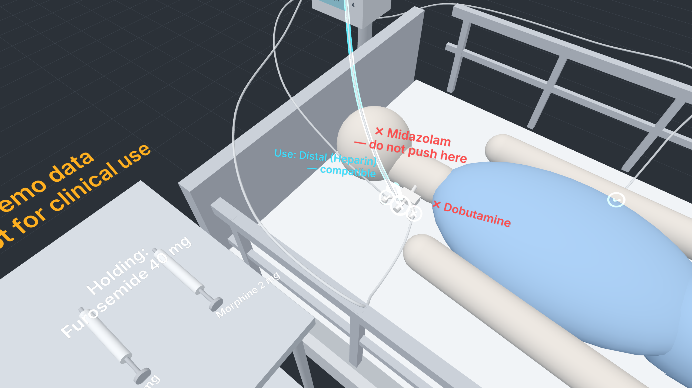
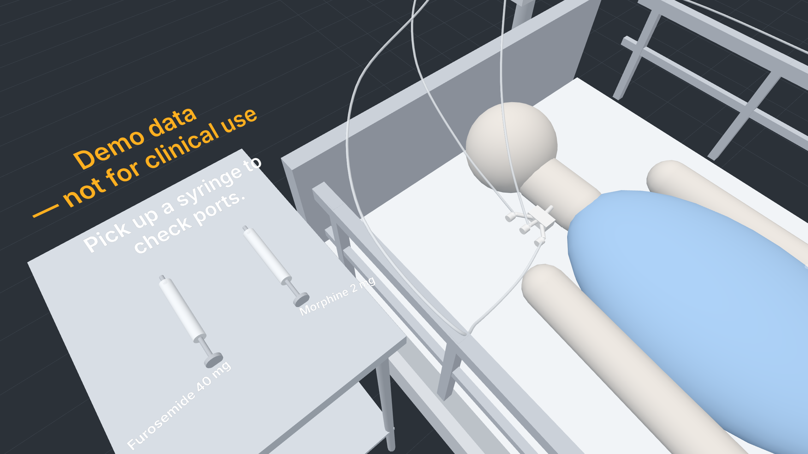
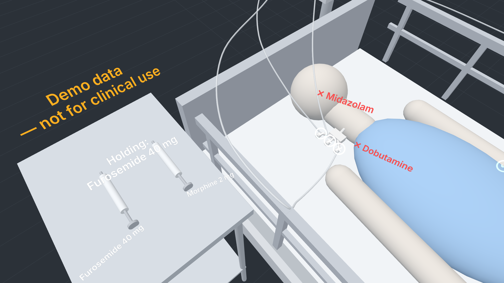
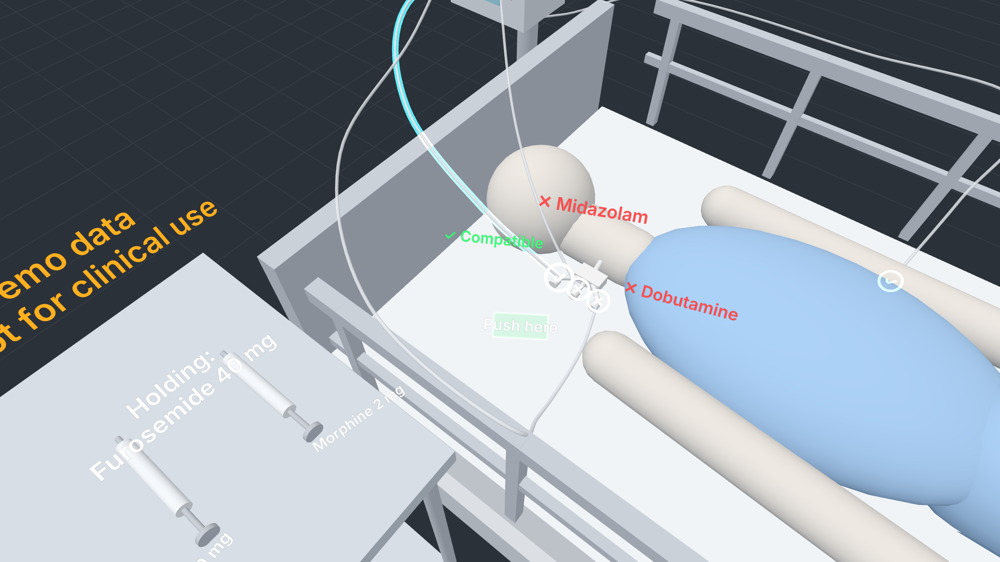
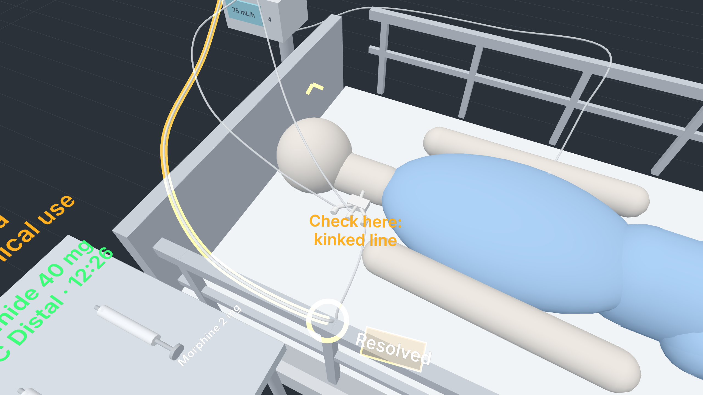
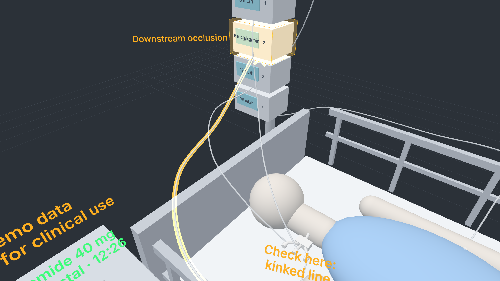
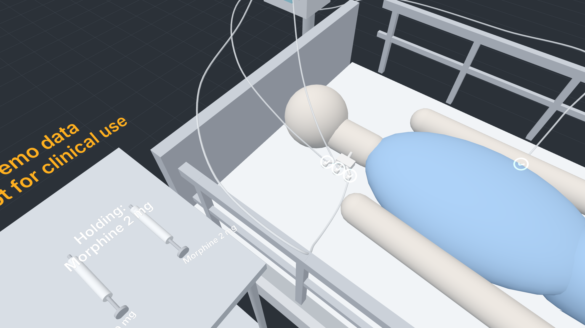
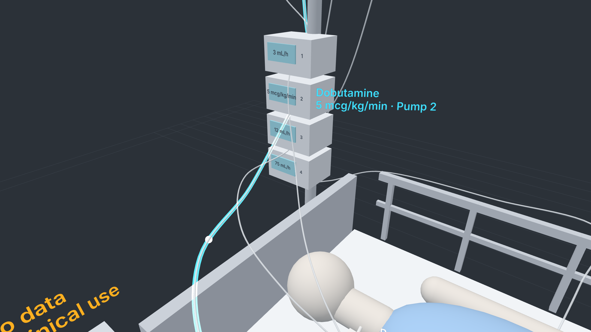
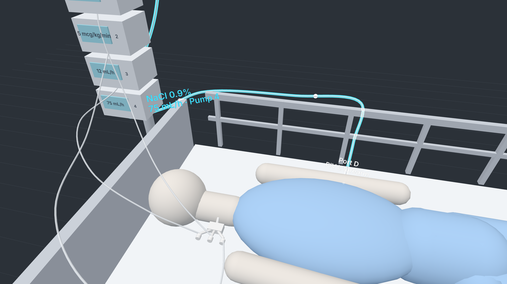

# Lumen

**Lumen: an AR Lens for SPECS that shows ICU nurses which IV port is safe for the drug in their hand, and lights any line from port to pump.**

> **Hackathon prototype. Demo data only. Not a medical device. Not for clinical use.**

*Learn AR with SPECS (Devpost Learn) · Lens Studio 5.23.2 · TypeScript*

## Demo video

▶ **YouTube:** _add the public link here after upload_ (script: [`devpost/LUMEN_SPEC.md` §13](devpost/LUMEN_SPEC.md))



## The problem

An ICU patient often has several IV drugs running at once: each one flows from a bag, through a pump,
down a tube into a port on a central line or a peripheral IV. The tubes hang, cross and tangle. Before
every push, the nurse has to answer two questions — *which line is this?* and *will my drug react with
what is already flowing in it?* — by tracing tubes with gloved fingers and checking a compatibility chart,
often on a computer away from the bed. Wrong-line and incompatible-drug errors are a known category of
IV medication error.

## Who it's for

**Maya, ICU nurse, 4 years in.** 1–2 critically ill patients per 12-hour shift, gloves on, syringe in hand.
She wants speed, certainty and her eyes on the patient — not menus, typing, floating screens or alerts
that never stop. Also: new-graduate and float nurses who don't know this patient's lines, and nurse educators.

## What it does

The Lens is almost silent at the bedside: faint dots on the ports. Maya picks up the **furosemide**
syringe — every port turns **green ✓** or **red ✕**, with the reason right on the port
(“✕ Midazolam”, “✕ Dobutamine”). She pinches the red Medial port: its tube lights **cyan** through the
tangle up to *Midazolam · 3 mL/h · Pump 1*, and a cyan arrow points to the nearest safe port —
“Use: Distal (Heparin) — compatible”. She pinches the Distal port, a big **Push here** appears; she
pinches it — a green pulse, a chime, a log line “Furosemide 40 mg → CVC Distal · 10:42” — and the Lens
goes quiet. Seconds later Pump 2 alarms out of view: a two-tone sound and an **amber edge arrow** turn
her to it, and Line 2 glows amber down to the **kinked** tube at the bed rail. “Resolved.” With
**morphine**, all four ports are green — the colours come from data, not fixed art.

**Shift handoff, one pinch.** At every handover ICU nurses trace each line from bag to patient. Pinch the
IV pole and Lumen walks the lines for you — each one lights from bag through pump to port with its drug,
rate and port name, 2.5 s each — then goes quiet and logs *“Lines checked · 4 of 4 · 07:02”*.

**Fail-safe by design.** A drug pair missing from the table is never green (“✕ Not in table — check
chart”), and if no port on the patient is safe, Lumen draws no arrow to nowhere: it says
*“No safe port — ask pharmacy”*.

| | |
|---|---|
|  |  |
|  |  |
|  |  |
|  |  |

## Why glasses

| Strength | In Lumen |
|---|---|
| **It shares your view** | The nurse looks at a port; Lumen answers about *that* port. |
| **It draws in the world** | The line lights up along the real tube, through the tangle, to the real pump and bag. Markers sit *on* the ports. |
| **It leaves your body free** | Gloved hands stay on the syringe. Eyes stay on the patient. No trip to a computer. |

On a phone you'd need a free hand, you'd hold it up, and you'd see a *picture* of the tangle instead of the
real one lighting up.

## How it was built

```
Assets/Lumen/Core/   engine-agnostic: LumenData (the ONLY data file) · CompatibilityEngine · LumenState
                     (state machine) · LumenLayout · Curves · ViewMath · MeshGen · SoundSynth · Scenarios (DC1–DC8)
Assets/Lumen/Lens/   Lens Studio: LumenLens (the one @component) · SceneBuilder · PortMarker · LineTracer ·
                     SyringeTray · PushButton · RedirectArrow · AlarmController · EdgeArrow · AudioCues · LumenSelfTest
Assets/Lumen/Audio/  7 spatial sound cues, synthesised in code (tools/gen-audio.ts)
preview-web/         a browser twin of the Lens Studio preview, rendering the same Core with Three.js
tests/               unit (Node), e2e (Playwright) — all run in GitHub Actions on every PR
devpost/             spec, LEAF results, build log, screenshots
```

- **Plan:** Devpost Learn skill pack, `plan-lens` → `devpost/design-brief.md` (see checklist below).
- **Build:** Claude Code. Everything in the Lens is generated at runtime from the shared Core
  (procedural meshes via `MeshBuilder`, SIK pinch targets, spatial audio) by one component, `LumenLens`,
  so the scene setup is: add one component, assign two materials and seven sounds
  ([LENS_STUDIO_SETUP.md](LENS_STUDIO_SETUP.md)). The hackathon asks for the build to go through
  **CLAD + Lens Studio MCP**; the setup guide has the CLAD prompt for wiring and LEAF-testing it.
- **Visuals never decide logic:** every engine renders `LumenState.view()`. The same DC1–DC8 scenarios
  run against the state machine, the rendered web preview, and inside the Lens Studio preview.
- **Lens Studio 5.23.2**, SPECS Base Template, Spectacles Interaction Kit, TypeScript.

## Stand-ins (what is faked in the preview)

| Real product would… | In the preview Lumen… |
|---|---|
| Scan the syringe barcode with the camera | Pinch a 3D syringe on the cart (“pick up”) |
| See and follow real tubes with computer vision | Uses hard-coded line paths in the scene |
| Get drug names and rates from connected pumps / EHR | Uses hard-coded data in one data file |
| Use a licensed compatibility database | Uses a small hard-coded table (demo data; anything missing is never green) |
| Detect a real pump alarm over the network | Fires the alarm 4 s after the first confirmed push (plus a hidden test hook) |

## LEAF results

See [`devpost/leaf-results.md`](devpost/leaf-results.md). DC1–DC8 pass on the state machine and in the
rendered web preview in CI (plus fuzzing and real-click stress tests). The Lens Studio preview column is
filled by running the in-preview self-test (setup step 5).

## How to open

**Lens Studio:** clone, open the `.esproj` in **Lens Studio 5.23.2**, press **Preview**
(first time: follow [LENS_STUDIO_SETUP.md](LENS_STUDIO_SETUP.md)). Controls: WASD move, Q/E down/up,
mouse look, **click = pinch**.

**Web preview (no Lens Studio needed):**

```bash
npm ci
```

```bash
npm run serve:web
```

Then open http://localhost:5173 — drag to look, **click = pinch**, F = SPECS 37° × 32° view, M = mute.

**Tests:**

```bash
npm test
```

```bash
npx playwright test
```

## What I learned

_Draft — rewrite in your own words before submitting:_

- The hard part is not the code; it is deciding when the Lens should be quiet.
- Put information on the thing it's about: a label on the port beats a panel in the air.
- Fake the sensing, build the response for real.
- SPECS sees only ~37° × 32°: the layout (where the cart sits, how long a label may be) had to be
  designed against that number, and tested against it.

## What's next

1. Real barcode scan of the syringe with the glasses camera.
2. Pump data over hospital interoperability standards instead of hard-coded data.
3. Vision-based line tracing on real tubes.
4. A licensed compatibility database.
5. A pilot with one ICU and nurse educators — training use first.
6. Regulatory path: in clinical use this is likely software as a medical device; start in training/simulation.

## Disclaimer

Hackathon prototype. Demo data only. Not a medical device. Not for clinical use.
All drug data in this repo is invented for a demo and has not been checked for clinical use.

---

### Submission checklist status

| Item | Status |
|---|---|
| Lens code, data, layout, sounds, tests, CI | ✅ in this repo |
| DC1–DC8 (+ DC9 handoff, DC10 fail-safe) on state machine + rendered web preview | ✅ green in CI |
| `devpost/design-brief.md` from **your own** `plan-lens` interview | ⏳ you — run `plan-lens` (spec §10 step 2) |
| Lens Studio project files (`.esproj`, scene) + scene wiring | ⏳ you — [LENS_STUDIO_SETUP.md](LENS_STUDIO_SETUP.md) steps 1–2 (or via CLAD, step 6) |
| DC1–DC8 in the Lens Studio preview | ⏳ you — setup step 5, paste the table into `devpost/leaf-results.md` |
| Demo video (public YouTube, < 3:00) + Devpost form | ⏳ you — script in spec §13, text in [`devpost/submission.md`](devpost/submission.md) |
